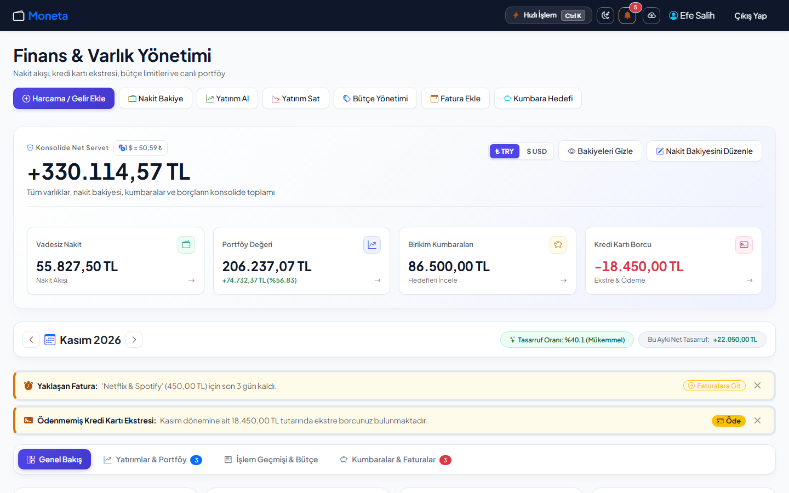
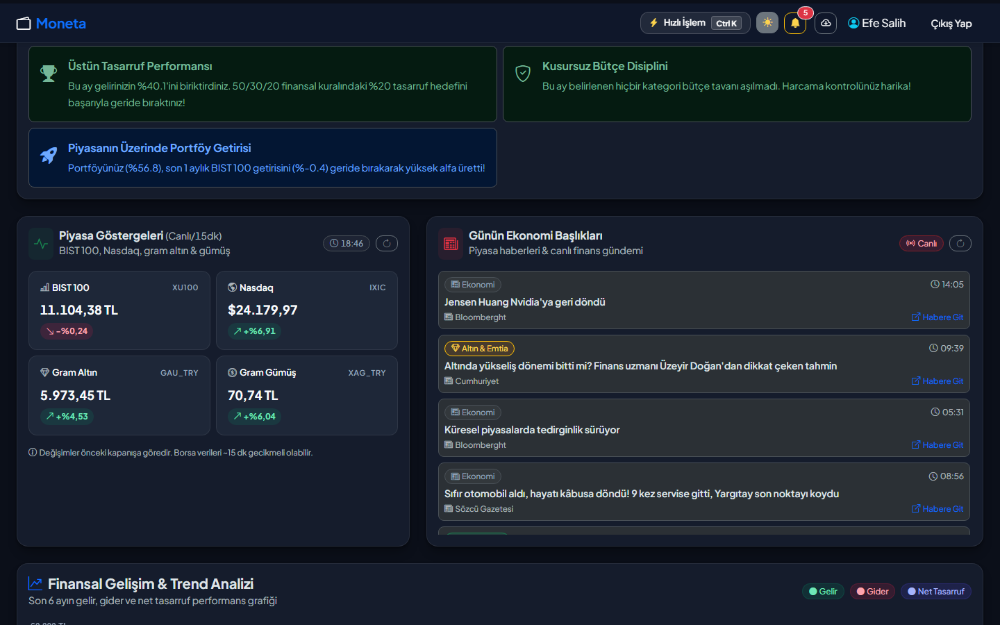
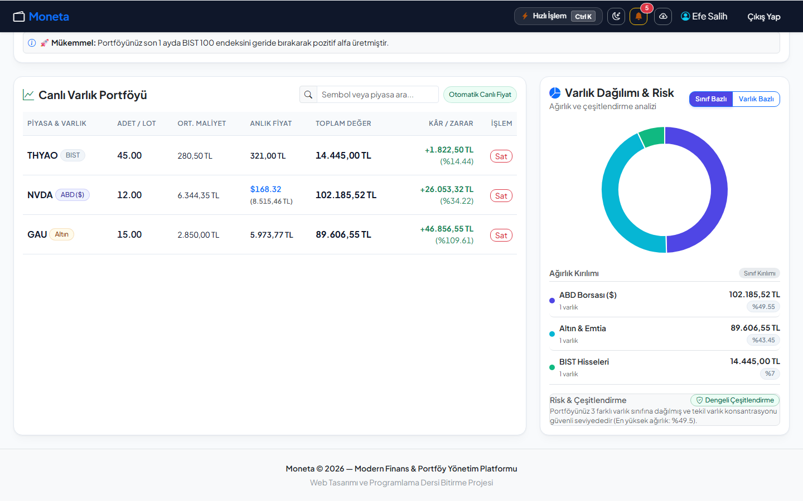
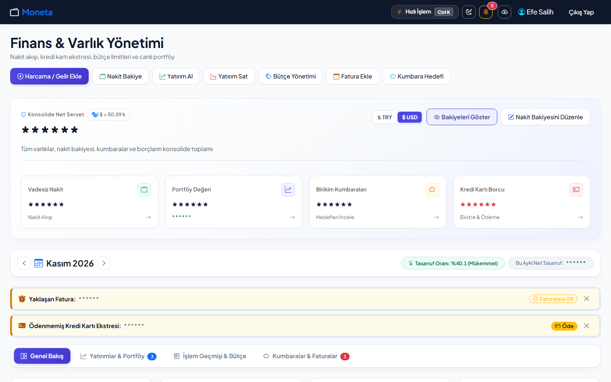
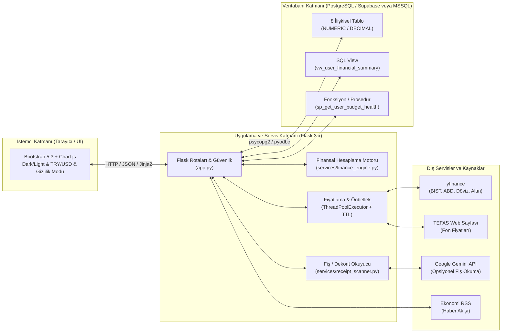
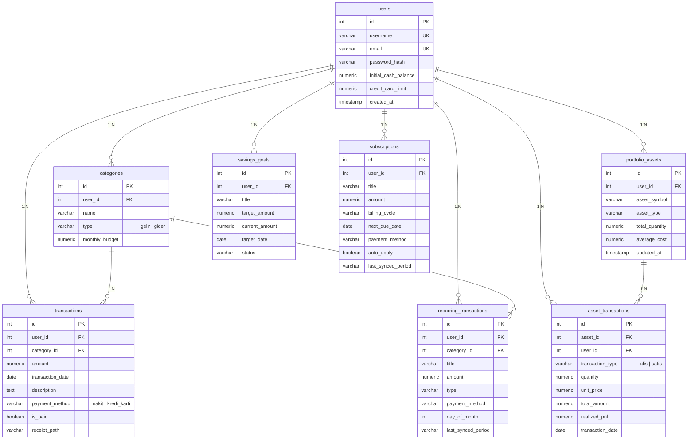

# 🏛️ Moneta — Kişisel Bütçe, Portföy ve Servet Takip Sistemi

> **Önemli Not:** Bu uygulama yatırım tavsiyesi vermez. 18 yaş ve üzeri kullanıcılar içindir.

[](https://www.python.org/)
[](https://flask.palletsprojects.com/)
[](https://supabase.com/)
[](https://www.microsoft.com/sql-server)
[](https://getbootstrap.com/)
[](https://www.chartjs.org/)
[](#6-otomatik-test-paketi-pytest)

**Moneta**, bireysel kullanıcıların nakit akışını, kredi kartı borç/limit durumunu, birikim hedeflerini (kumbara), düzenli fatura/abonelik takibini ve çoklu varlık yatırım portföylerini (**BIST Hisseleri**, **ABD Borsaları**, **TEFAS/BEFAS Fonları**, **Gram Altın** ve **Döviz**; *kripto varlık desteği planlanıyor*) tek bir ekranda izlemelerini sağlayan web tabanlı bir kişisel finans ve portföy takip uygulamasıdır.

---

## 📸 Arayüz ve Kullanım Galerisi

| Genel Bakış & Nakit Akışı (Açık Tema) | Genel Bakış & Canlı Piyasa (Karanlık Tema) |
| :---: | :---: |
|  |  |
| **Yatırım Portföyü & Varlık Dağılım Grafikleri** | **Gizlilik Modu (`******`) & `$ USD` Görünümü** |
|  |  |

---

## 📑 İçindekiler
1. [Temel Yetenekler, Veri Kaynakları ve Fiş Okuma](#1-temel-yetenekler-veri-kaynakları-ve-fiş-okuma)
2. [Sistem Mimarisi ve Veritabanı ER Diyagramı](#2-sistem-mimarisi-ve-veritabanı-er-diyagramı)
3. [Finansal Hesaplama Motoru](#3-finansal-hesaplama-motoru)
4. [Arayüz Özellikleri ve Erişilebilirlik](#4-arayüz-özellikleri-ve-erişilebilirlik)
5. [Adım Adım Kurulum ve Çalıştırma Rehberi](#5-adım-adım-kurulum-ve-çalıştırma-rehberi)
6. [Otomatik Test Paketi (Pytest)](#6-otomatik-test-paketi-pytest)
7. [Proje Dizin Yapısı](#7-proje-dizin-yapısı)

---

## 1. Temel Yetenekler, Veri Kaynakları ve Fiş Okuma

Moneta; gelir-gider kayıtları, yatırım portföyü, enflasyon (TÜFE) karşılaştırması, kredi kartı ekstre devri ve vadesiz nakit bakiyesi arasındaki çift yönlü muhasebe bağını birlikte takip eder:

* **Çift Yönlü Nakit, Portföy ve Kumbara Senkronizasyonu:** Portföyden hisse/altın/fon alındığında veya kumbaraya para aktarıldığında vadesiz nakit bakiyesi otomatik düşer; satış veya kumbara bozdurma işleminde anapara + realize kâr nakit bakiyesine eklenir. İşlem silindiğinde veya düzenlendiğinde ilgili kumbara ve kredi kartı ekstre durumları geriye dönük güncellenir.
* **Çoklu Varlık Fiyatlama ve Önbellek (`ThreadPoolExecutor` + `5 dk TTL Cache`):** Portföyde Borsa İstanbul (`.IS`), ABD Borsaları (`AAPL`, `NVDA` vb. `USD/TRY` kur dönüşümüyle), TEFAS/BEFAS Yatırım Fonları, Gram Altın (`ONS * USDTRY / 31.1035`) ve Döviz (`USD`, `EUR`, `GBP`) paralel iş parçacıklarıyla sorgulanır. Üst piyasa özet bandında ek olarak Nasdaq ve Gram Gümüş gösterilir (*kripto varlık fiyatlaması planlanmaktadır*).
* **Veri Kaynakları Hakkında Bilgi:** Fiyat verileri resmî olmayan kaynaklardan (`yfinance` kütüphanesi ve `tefas.gov.tr` fon sayfası HTML ayrıştırması) çekilir; veriler gecikmeli, eksik veya hatalı olabilir. Dış kaynaklara erişilemediğinde sistem son önbellek değerine veya alış maliyeti / yapılandırılmış yedek kura düşer.
* **Fiş ve Dekont Okuyucu (`services/receipt_scanner.py`):** İşlem ekleme ekranındaki fiş/fatura tarama özelliği, `GEMINI_API_KEY` tanımlı olduğunda yüklenen fiş ve dekont görsellerini/PDF'lerini analiz için **Google Gemini API** servisine gönderir. API anahtarı tanımlı değilse veya harici servise ulaşılamazsa yerel yedek okuyucu (`pypdf` + Türkçe regex/dosya adı ayrıştırıcısı) kullanılır. `GEMINI_PAID_TIER_CONFIRMED=true` olarak ayarlanmadığı sürece arayüzde demo modu uyarısı gösterilir.
* **Aylık Fatura & Düzenli İşlem Otomasyonu (`auto_sync_monthly_obligations`):** Sabit abonelikler ve düzenli gelir/gider şablonları, her yeni dönemde (`YYYY-MM`) mükerrer kayıt üretmeden dönem işlemlerine yansıtılır.

---

## 2. Sistem Mimarisi ve Veritabanı ER Diyagramı

### 2.1. Katmanlı Sistem Akış Diyagramı

Moneta çift veritabanı motorunu destekler: `DATABASE_URL` tanımlıysa **PostgreSQL / Supabase** (`psycopg2-binary`), tanımlı değilse **Microsoft SQL Server** (`pyodbc`) kullanılır.



### 2.2. İlişkisel Veritabanı Şeması (ER Diyagramı)

Veritabanı ([`schema_postgres.sql`](schema_postgres.sql) ve [`schema.sql`](schema.sql)), **8 ilişkisel tablo**, **2 bileşik indeks**, **1 SQL View** ve **1 bütçe sağlığı fonksiyonu/prosedürü** içerir:



### 2.3. Veritabanı Görünüm ve Fonksiyon Nesneleri
* **`vw_user_financial_summary` (SQL View):** Kullanıcının başlangıç nakit bakiyesini, kredi kartı limitini, nakit gelir/gider toplamlarını, ödenmemiş kredi kartı ekstre borcunu, aktif kumbara birikimini ve aktif portföy varlık sayısını tek sorguda birleştirir.
* **`sp_get_user_budget_health` (PostgreSQL Function / MSSQL Stored Procedure):** Kullanıcı, ay ve yıl parametrelerini alarak kategori bazlı bütçe tavanlarını, dönem içi harcamaları, kalan limitleri ve kullanım yüzdesine göre durum kodlarını (`NORMAL`, `KRITIK` $\ge \%85$, `ASILDI` $> \%100$, `TANIMSIZ`) hesaplar.

---

## 3. Finansal Hesaplama Motoru

Finansal hesaplamalar [`services/finance_engine.py`](services/finance_engine.py) modülünde yer alır ve birim testlerle (`pytest`) doğrulanır:

### 3.1. Net Servet Denklemi ve Bilanço İçi Transfer Ayrımı
Yatırım alış/satışları, kumbara aktarımları ve kredi kartı borç ödemeleri (`INTERNAL_TRANSFER_CATEGORIES`) kullanıcının **Vadesiz Nakit Bakiyesini** güncellerken, aylık tüketim giderlerini (Market, Kira, Fatura vb.) şişirmez:

$$\text{Net Servet} = \text{Vadesiz Nakit} + \text{Portföy Piyasa Değeri} + \text{Kumbara Birikimleri} - \text{Ödenmemiş Kredi Kartı Borcu}$$

### 3.2. Fisher Denklemi ile Enflasyona (TÜFE) Karşı Reel Getiri Analizi
Nominal portföy getirisinin enflasyon karşısındaki alım gücü etkisini hesaplamak için **Fisher Denklemi** kullanılır:

$$\text{Reel Getiri (\%)} = \left( \frac{1 + R_{\text{nominal}}}{1 + \pi_{\text{TÜFE}}} - 1 \right) \times 100$$

* Nominal getiri pozitif olsa dahi enflasyonun altında kalındığında **`ENFLASYONİST ERİME`** uyarısı, enflasyon aşıldığında **`REEL ALFA (KÂR)`** durumu gösterilir.

### 3.3. Ağırlıklı Ortalama Maliyet (WAC) & Realize Kâr/Zarar (`realized_pnl`)
* Kademeli varlık alımlarında ağırlıklı ortalama maliyet:
  $$\text{WAC}_{\text{yeni}} = \frac{(Q_{\text{mevcut}} \times \text{WAC}_{\text{mevcut}}) + (Q_{\text{alınan}} \times P_{\text{alış}})}{Q_{\text{mevcut}} + Q_{\text{alınan}}}$$
* Kısmi veya tam satışlarda ortalama maliyet sabit tutulur ve gerçekleşen kâr/zarar (`realized_pnl`) işlem geçmişine kaydedilir:
  $$\text{Realize Kâr/Zarar} = (P_{\text{satış}} - \text{WAC}_{\text{mevcut}}) \times Q_{\text{satılan}}$$

### 3.4. Kredi Kartı Limit Doluluk Analizi
Kredi kartı borcunun toplam limite oranı üç eşiğe göre değerlendirilir:
* **$\%0 - \%30$ (`İdeal Limit Kullanımı`):** Düşük limit kullanım oranı.
* **$\%30 - \%70$ (`Orta Risk - Dikkat`):** Ekstre kesimi öncesi ara ödeme değerlendirilebilir.
* **$\%70+$ (`Yüksek Risk - Kredi Notu Baskısı`):** Yüksek limit doluluk uyarısı.

---

## 4. Arayüz Özellikleri ve Erişilebilirlik

Arayüz, klavye navigasyonu, ARIA etiketleri ve renk kontrastı gibi erişilebilirlik ilkeleri gözetilerek tasarlanmıştır:

* **Karanlık & Açık Tema (`Dark / Light Mode`):** Sistem tercihi veya üst bardaki tema anahtarı ile tablolar, modallar ve Chart.js grafikleri tema değiştirir.
* **Canlı `₺ TRY / $ USD` Para Birimi Değiştirici:** Ana ekrandaki bakiyeler, tablolar ve grafik ipuçları (`tooltip`) `USD/TRY` kuru üzerinden tek tıkla Dolar (`$`) veya Türk Lirası (`₺`) görünümüne geçer.
* **Yıldız (`******`) Maskelemeli Gizlilik Modu (`Alt + P` & `Hover-to-Peek`):** Finansal tutarlar ve grafik eksenleri `******` ile gizlenir; fare ile ilgili kartın üzerine gelindiğinde yalnızca o tutar geçici olarak görünür.
* **Klavye Kısayolları:**
  * `Ctrl + K`: Hızlı Komut Paleti
  * `N`: Yeni İşlem Ekleme Modalı
  * `Alt + P`: Gizlilik Modu Aç/Kapat
* **Sekme & Dönem Hafızası (`State Persistence`):** Geçmiş bir ay veya alt sekme incelenirken işlem eklendiğinde/silindiğinde seçili dönem ve açık sekme korunur.

---

## 5. Adım Adım Kurulum ve Çalıştırma Rehberi

### Ön Gereksinimler
* **Python 3.10+** (Önerilen: Python 3.13)
* **Veritabanı (birini seçin):**
  * **PostgreSQL / Supabase** (`DATABASE_URL` bağlantı adresi ile ek sürücü kurulumu gerekmez), *veya*
  * **Microsoft SQL Server** (Express / Developer / Standard) ve **ODBC Driver 17 for SQL Server** (yerel Windows ortamı için)

### 1. Projeyi Klonlayın ve Sanal Ortamı Kurun
```powershell
git clone https://github.com/kullanici/moneta.git
cd moneta
python -m venv venv
.\venv\Scripts\activate
pip install -r requirements.txt
```

### 2. Ortam Değişkenlerini (`.env`) Yapılandırın
`.env.example` dosyasını `.env` olarak kopyalayın:
```powershell
copy .env.example .env
```

`FLASK_SECRET_KEY` için aşağıdaki komutla en az 32 karakterlik güçlü, rastgele bir anahtar üretin (üretim ortamında zorunludur):
```powershell
python -c "import secrets; print(secrets.token_hex(32))"
```

`.env` dosyanızı veritabanı tercihinize göre düzenleyin:
```ini
FLASK_SECRET_KEY=<rastgele_uretilmis_bir_deger_girin>
FLASK_ENV=development

# Seçenek A — PostgreSQL / Supabase:
DATABASE_URL=postgresql://postgres.<proje_ref>:<sifre>@<pooler_host>:6543/postgres?sslmode=require

# Seçenek B — Yerel Microsoft SQL Server (DATABASE_URL boş bırakıldığında kullanılır):
DB_DRIVER={ODBC Driver 17 for SQL Server}
DB_SERVER=LOCALHOST\SQLEXPRESS
DB_DATABASE=wealth_tracker_db
DB_TRUSTED_CONNECTION=yes
DB_TRUST_SERVER_CERTIFICATE=yes
```

### 3. Veritabanını Kurun (`init_db.py`)
Aşağıdaki komut aktif veritabanı motoruna göre ([`schema_postgres.sql`](schema_postgres.sql) veya [`schema.sql`](schema.sql)) 8 tabloyu, indeksleri, `vw_user_financial_summary` görünümünü ve `sp_get_user_budget_health` fonksiyonunu/prosedürünü oluşturur:
```powershell
python init_db.py
```

### 4. Uygulamayı Çalıştırın
* **Geliştirme Modu:**
  ```powershell
  python app.py
  ```
* **Yerel WSGI Sunucusu (`Waitress` - Windows):**
  ```powershell
  python run_prod.py
  ```
Tarayıcınızda `http://127.0.0.1:5000` adresine giderek uygulamayı kullanabilirsiniz.

---

## 6. Otomatik Test Paketi (`Pytest`)

Moneta; Fisher denklemi, WAC/Realized PnL hesaplamaları, kredi kartı doluluk eşikleri, portföy konsantrasyon analizi, PostgreSQL/MSSQL şema ve sorgu uyumluluğu, fiş okuyucu yedekleme zinciri, CSRF/oturum/çerez/gizli anahtar güvenliği ve dış API kesinti (`Offline Fallback`) senaryolarını kapsayan **69 adet otomatik birim ve entegrasyon testine** sahiptir:

```powershell
pytest tests/ -v
```

---

## 7. Proje Dizin Yapısı

```text
moneta/
├── app.py                          # Ana Flask uygulaması, rotalar, fiyatlama ve otomasyonlar
├── config.py                       # Ortam değişkenleri, güvenlik doğrulaması ve DB yapılandırması
├── db.py                           # PostgreSQL (psycopg2) ve MSSQL (pyodbc) çift motorlu DB katmanı
├── init_db.py                      # Veritabanı tablo, View ve fonksiyon/prosedür kurulum betiği
├── seed_demo_data.py               # Örnek finansal demo verisi yükleme betiği
├── schema.sql                      # Microsoft SQL Server (T-SQL) veritabanı şeması
├── schema_postgres.sql             # PostgreSQL / Supabase veritabanı şeması
├── run_prod.py                     # Waitress tabanlı yerel WSGI sunucu başlatıcısı
├── requirements.txt                # Python bağımlılık listesi
├── .env.example                    # Örnek ortam değişkenleri şablonu
├── services/
│   ├── __init__.py
│   ├── finance_engine.py           # Fisher denklemi, WAC, PnL, kredi doluluk ve girdi doğrulama
│   └── receipt_scanner.py          # Gemini Vision API + yerel pypdf/regex fiş ve dekont okuyucu
├── templates/
│   ├── base.html                   # Ana şablon, üst navigasyon, bildirimler ve komut paleti
│   ├── dashboard.html              # 4 sekmeli ana kontrol paneli ve Chart.js grafikleri
│   ├── login.html                  # Kullanıcı giriş ekranı
│   ├── register.html               # Yeni kullanıcı kayıt ekranı
│   ├── 403.html                    # Özel 403 Güvenlik / CSRF doğrulama ekranı
│   ├── 404.html                    # Özel 404 Sayfa Bulunamadı ekranı
│   └── 500.html                    # Özel 500 hata ekranı
├── static/
│   └── css/
│       └── fintech-theme.css       # Arayüz stilleri, karanlık tema ve duyarlı (responsive) kurallar
└── tests/
    ├── test_moneta.py              # Finansal motor, DB View/Fonksiyon ve rota güvenlik testleri
    └── test_production_readiness.py# Güvenlik, PostgreSQL/Vercel uyumu, fiş okuyucu ve E2E testler
```
