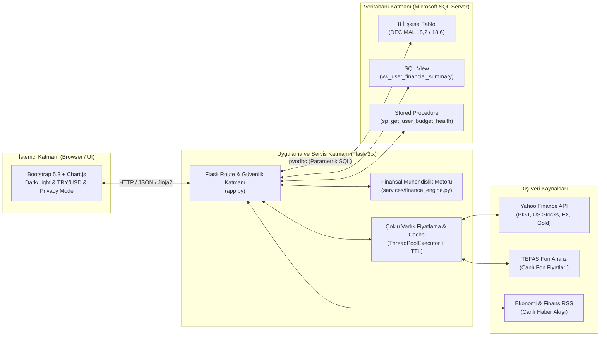
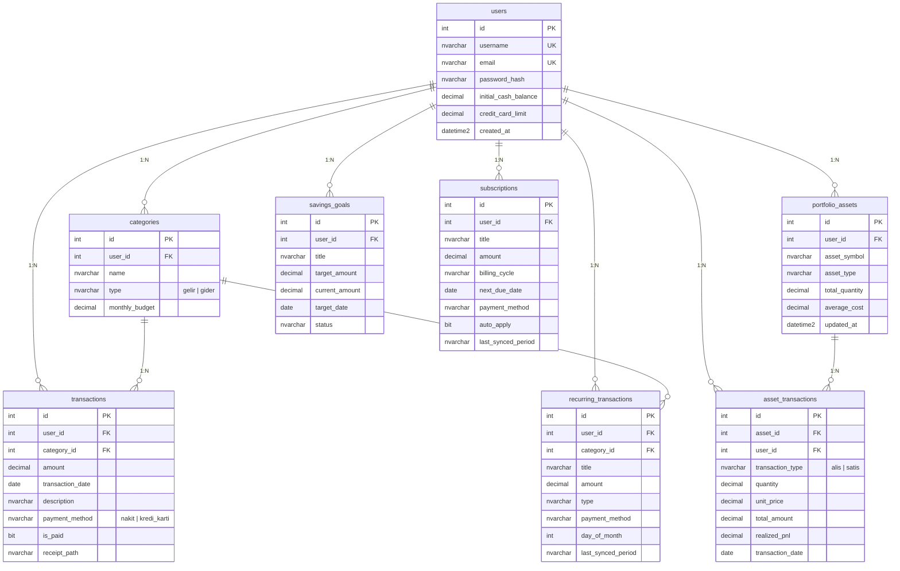

# 🏛️ Moneta — Akıllı Bütçe, Portföy ve Servet Yönetim Sistemi

[](https://www.python.org/)
[](https://flask.palletsprojects.com/)
[](https://www.microsoft.com/sql-server)
[](https://getbootstrap.com/)
[](https://www.chartjs.org/)
[](https://www.w3.org/WAI/WCAG21/quickref/)
[](#6-otomatik-test-paketi-pytest)

**Moneta**, bireysel yatırımcıların nakit akışını, kredi kartı borç/limit sağlığını, birikim hedeflerini (kumbara), düzenli fatura/abonelik otomasyonunu ve çoklu varlık yatırım portföylerini (**BIST 100**, **ABD Borsaları**, **TEFAS/BEFAS Fonları**, **Gram Altın/Gümüş**, **Döviz** ve **Kripto**) tek bir merkezi finansal karar destek ekranında yönetmelerini sağlayan kurumsal düzeyde bir **FinTech Web Uygulamasıdır**.

---

## 📑 İçindekiler
1. [Proje Vizyonu ve Temel Yetenekler](#1-proje-vizyonu-ve-temel-yetenekler)
2. [Sistem Mimarisi ve Veritabanı ER Diyagramı](#2-sistem-mimarisi-ve-veritabanı-er-diyagramı)
3. [Finansal Mühendislik ve Karar Destek Motoru](#3-finansal-mühendislik-ve-karar-destek-motoru)
4. [Modern SaaS UI/UX ve Erişilebilirlik (WCAG 2.1 AA/AAA)](#4-modern-saas-uiux-ve-erişilebilirlik-wcag-21-aaaaa)
5. [Adım Adım Kurulum ve Çalıştırma Rehberi](#5-adım-adım-kurulum-ve-çalıştırma-rehberi)
6. [Otomatik Test Paketi (Pytest)](#6-otomatik-test-paketi-pytest)
7. [Proje Dizin Yapısı](#7-proje-dizin-yapısı)

---

## 1. Proje Vizyonu ve Temel Yetenekler

Geleneksel bütçe uygulamaları yalnızca gelir-gider takibi yaparken, yatırım portföyü, enflasyonist erime (TÜFE), kredi kartı ekstre devri ve vadesiz nakit bakiyesi arasındaki çift yönlü (bi-directional) muhasebe bağını göz ardı eder. **Moneta**, bu kopukluğu ortadan kaldırarak tam entegre bir bilanço motoru sunar:

* **Çift Yönlü (Bi-Directional) Nakit & Portföy & Kumbara Senkronizasyonu:** Portföyden hisse/altın/fon alındığında veya kumbaraya para aktarıldığında vadesiz nakit bakiyesi otomatik düşer; satış veya kumbara bozdurma işleminde anapara + realize kâr nakit bakiyesine otomatik eklenir. İşlem silindiğinde veya düzenlendiğinde ilgili kumbara ve kredi kartı ekstre durumları geriye dönük otomatik senkronize edilir.
* **Çoklu Varlık Canlı Fiyatlama Motoru (`ThreadPoolExecutor` + `5 dk TTL Cache`):** Borsa İstanbul (`.IS`), ABD Borsaları (`AAPL`, `NVDA` vb. canlı `USD/TRY` çapraz kur dönüşümüyle), TEFAS/BEFAS Yatırım Fonları (canlı web scraping), Gram Altın/Gümüş (`ONS * USDTRY / 31.1035`) ve Kripto varlıklar paralel iş parçacıklarıyla (`ThreadPoolExecutor`) 1 saniyenin altında fiyatlanır.
* **Tam Otomatik Aylık Fatura & Düzenli İşlem Motoru (`sync_monthly_automations`):** Sabit abonelikler ve düzenli gelir/gider şablonları, her yeni dönemde (`YYYY-MM`) mükerrer kayıt üretmeden otomatik olarak dönem işlemlerine dönüştürülür.

---

## 2. Sistem Mimarisi ve Veritabanı ER Diyagramı

### 2.1. Katmanlı Sistem Akış Diyagramı



### 2.2. İlişkisel Veritabanı Şeması (ER Diyagramı)

Veritabanı (`wealth_tracker_db`), **3. Normal Form (3NF)** kurallarına uygun **8 ilişkisel tablo**, **2 bileşik performans indeksi**, **1 SQL View** ve **1 Stored Procedure** nesnesinden oluşur:



### 2.3. Kurumsal Veritabanı Nesneleri (View & Stored Procedure)
* **`vw_user_financial_summary` (SQL View):** Kullanıcının başlangıç nakit bakiyesini, kredi kartı limitini, tüm zamanlar nakit gelir/gider toplamlarını, ödenmemiş kredi kartı ekstre borcunu, aktif kumbara birikimini ve aktif portföy varlık sayısını tek bir atomik sorguda birleştirir.
* **`sp_get_user_budget_health` (Stored Procedure):** `@user_id`, `@month`, `@year` parametrelerini alarak kategori bazlı bütçe tavanlarını, dönem içi harcamaları, kalan limitleri ve kullanım yüzdesine göre durum kodlarını (`NORMAL`, `KRITIK` $\ge \%85$, `ASILDI` $> \%100$, `TANIMSIZ`) doğrudan SQL motorunda hesaplar.

---

## 3. Finansal Mühendislik ve Karar Destek Motoru

Tüm finansal hesaplamalar [`services/finance_engine.py`](services/finance_engine.py) modülünde izole edilmiş olup birim testlerle (`pytest`) doğrulanmaktadır:

### 3.1. Dinamik Net Servet Denklemi ve Bilanço İçi Transfer Ayrımı
Yatırım alış/satışları, kumbara aktarımları ve kredi kartı borç ödemeleri (`INTERNAL_TRANSFER_CATEGORIES`) kullanıcının **Vadesiz Nakit Bakiyesini** doğrudan güncellerken, aylık tüketim giderlerini (Market, Kira, Fatura vb.) yapay olarak şişirmez:

$$\text{Net Servet} = \text{Vadesiz Nakit} + \text{Portföy Piyasa Değeri} + \text{Kumbara Birikimleri} - \text{Ödenmemiş Kredi Kartı Borcu}$$

### 3.2. Fisher Denklemi ile Enflasyona (TÜFE) Karşı Reel Getiri Analizi
Nominal portföy getirisinin enflasyon karşısındaki gerçek alım gücü etkisini ölçmek için **Tam Fisher Denklemi** kullanılır:

$$\text{Reel Getiri (\%)} = \left( \frac{1 + R_{\text{nominal}}}{1 + \pi_{\text{TÜFE}}} - 1 \right) \times 100$$

* Nominal getiri pozitif olsa dahi enflasyonun altında kalındığında sistem **`ENFLASYONİST ERİME`** uyarısı üretir; enflasyon aşıldığında **`REEL ALFA (KÂR)`** olarak sınıflandırır.

### 3.3. Ağırlıklı Ortalama Maliyet (WAC) & Realize Kâr/Zarar (`realized_pnl`)
* Kademeli varlık alımlarında ağırlıklı ortalama maliyet:
  $$\text{WAC}_{\text{yeni}} = \frac{(Q_{\text{mevcut}} \times \text{WAC}_{\text{mevcut}}) + (Q_{\text{alınan}} \times P_{\text{alış}})}{Q_{\text{mevcut}} + Q_{\text{alınan}}}$$
* Kısmi veya tam satışlarda ortalama maliyet sabit tutulur ve gerçekleşen kâr/zarar (`realized_pnl`) işlem geçmişine kaydedilir:
  $$\text{Realize Kâr/Zarar} = (P_{\text{satış}} - \text{WAC}_{\text{mevcut}}) \times Q_{\text{satılan}}$$

### 3.4. Findeks / FICO Kredi Kartı Limit Doluluk Analizi
Kredi kartı borcunun toplam limite oranı değerlendirilerek kullanıcıya kredi notu sağlığı bildirilir:
* **$\%0 - \%30$ (`İdeal Limit Kullanımı`):** Kredi notu için optimal güvenli bölge.
* **$\%30 - \%70$ (`Orta Risk - Dikkat`):** Ekstre kesimi öncesi ara ödeme önerisi.
* **$\%70+$ (`Yüksek Risk - Kredi Notu Baskısı`):** Findeks notunu düşürebilecek kritik doluluk uyarısı.

---

## 4. Modern SaaS UI/UX ve Erişilebilirlik (WCAG 2.1 AA/AAA)

* **Karanlık & Açık Tema (`Dark / Light Mode`):** Sistem tercihi veya üst bardaki tema anahtarı ile tüm tablolar, modallar ve Chart.js grafikleri anında tema değiştirir.
* **Canlı `₺ TRY / $ USD` Para Birimi Değiştirici:** Ana ekrandaki tüm bakiyeler, tablolar ve Chart.js grafik ipuçları (`tooltip`) canlı `USD/TRY` kuru üzerinden tek tıkla Dolar (`$`) veya Türk Lirası (`₺`) görünümüne geçer.
* **Yıldız (`******`) Maskelemeli Gizlilik Modu (`Alt + P` & `Hover-to-Peek`):** Kamuya açık alanlarda tüm finansal tutarlar ve grafik eksenleri `******` ile gizlenir; fare ile ilgili kartın üzerine gelindiğinde (`Hover-to-Peek`) yalnızca o tutar geçici olarak görünür.
* **Klavye Kısayolları:**
  * `Ctrl + K`: Hızlı Komut Paleti (`Command Palette`)
  * `N`: Yeni İşlem Ekleme Modalı
  * `Alt + P`: Gizlilik Modu Aç/Kapat
* **Sekme & Dönem Hafızası (`State Persistence`):** Kullanıcı geçmiş bir ayı (`Eylül 2026`) veya `Yatırım Portföyü` / `Bütçe & Kumbara` sekmesini incelerken işlem eklediğinde veya sildiğinde seçili dönem ve açık sekme korunur.

---

## 5. Adım Adım Kurulum ve Çalıştırma Rehberi

### Ön Gereksinimler
* **Python 3.10+** (Önerilen: Python 3.13)
* **Microsoft SQL Server** (Express / Developer / Standard) ve **ODBC Driver 17 for SQL Server**

### 1. Projeyi Klonlayın ve Sanal Ortamı Kurun
```powershell
git clone https://github.com/kullanici/moneta.git
cd moneta
python -m venv venv
.\venv\Scripts\activate
pip install -r requirements.txt
```

### 2. Ortam Değişkenlerini (`.env`) Yapılandırın
`.env.example` dosyasını `.env` olarak kopyalayın ve kendi SQL Server sunucu adınızı (`DB_SERVER`) girin:
```powershell
copy .env.example .env
```
```ini
FLASK_SECRET_KEY=moneta_production_secret_key_2026
FLASK_ENV=development
DB_DRIVER={ODBC Driver 17 for SQL Server}
DB_SERVER=LOCALHOST\SQLEXPRESS
DB_DATABASE=wealth_tracker_db
DB_TRUSTED_CONNECTION=yes
DB_TRUST_SERVER_CERTIFICATE=yes
```

### 3. Veritabanını Tek Komutla Kurun (`init_db.py`)
Aşağıdaki komut `wealth_tracker_db` veritabanını, 8 tabloyu, indeksleri, `vw_user_financial_summary` View'ını ve `sp_get_user_budget_health` Stored Procedure nesnesini otomatik oluşturur (Alternatif olarak SSMS üzerinden [`schema.sql`](schema.sql) betiğini de çalıştırabilirsiniz):
```powershell
python init_db.py
```

### 4. Uygulamayı Çalıştırın
* **Geliştirme Modu:**
  ```powershell
  python app.py
  ```
* **Production WSGI Sunucusu (`Waitress`):**
  ```powershell
  python run_prod.py
  ```
Tarayıcınızda `http://127.0.0.1:5000` adresine giderek uygulamayı kullanmaya başlayabilirsiniz.

---

## 6. Otomatik Test Paketi (`Pytest`)

Moneta; Fisher denklemi, WAC/Realized PnL hesaplamaları, kredi kartı doluluk eşikleri, portföy konsantrasyon riski, MSSQL View/SP entegrasyonu, SQL Arithmetic Overflow koruması, CSRF/oturum/dosya güvenliği, çift yönlü veri tutarlılığı ve dış API kesinti (`Offline Fallback`) senaryolarını kapsayan **44 adet otomatik birim ve entegrasyon testine** sahiptir:

```powershell
pytest tests/ -v
```

---

## 7. Proje Dizin Yapısı

```text
moneta/
├── app.py                          # Ana Flask uygulaması, rotalar, fiyatlama motoru ve otomasyonlar
├── config.py                       # Ortam değişkenleri (.env) ve MSSQL bağlantı yapılandırması
├── db.py                           # ODBC bağlantı yöneticisi ve sürücü fallback mekanizması
├── init_db.py                      # Tek komutla sıfırdan veritabanı, tablo, View ve SP kurulum aracı
├── seed_demo_data.py               # Zengin demo verisi (BIST, ABD, Altın, faturalar, kumbaralar) yükleyici
├── schema.sql                      # Tüm veritabanı mimarisini içeren çalıştırılabilir T-SQL betiği
├── run_prod.py                     # Waitress tabanlı Production WSGI sunucu başlatıcısı
├── requirements.txt                # Python bağımlılık listesi
├── .env.example                    # Örnek ortam değişkenleri şablonu
├── services/
│   ├── __init__.py
│   └── finance_engine.py           # Fisher denklemi, WAC, PnL, kredi riski ve girdi sanitasyon motoru
├── templates/
│   ├── base.html                   # Ana şablon, üst navigasyon, bildirim merkezi ve komut paleti
│   ├── dashboard.html              # 4 sekmeli ana finansal kontrol paneli ve Chart.js görselleştirmeleri
│   ├── login.html                  # Kurumsal kullanıcı giriş ekranı
│   ├── register.html               # Yeni kullanıcı kayıt ekranı
│   ├── 403.html                    # Özel 403 Güvenlik / CSRF Doğrulama ekranı
│   ├── 404.html                    # Özel 404 Sayfa Bulunamadı ekranı
│   └── 500.html                    # Özel 500 Güvenli Hata İzolasyonu ekranı
├── static/
│   └── css/
│       └── fintech-theme.css       # Kurumsal SaaS tasarım sistemi, Dark Mode ve WCAG erişilebilirlik kuralları
└── tests/
    ├── test_moneta.py              # Finansal motor, MSSQL View/SP ve rota güvenlik birim testleri
    └── test_production_readiness.py# Stres testleri, SQL overflow, offline API ve çift yönlü tutarlılık testleri
```

